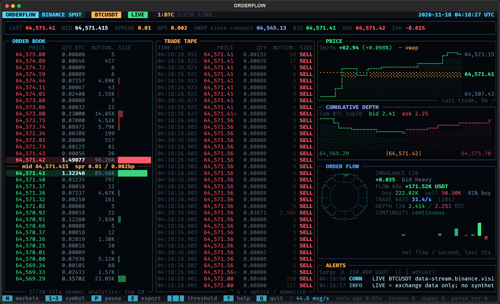
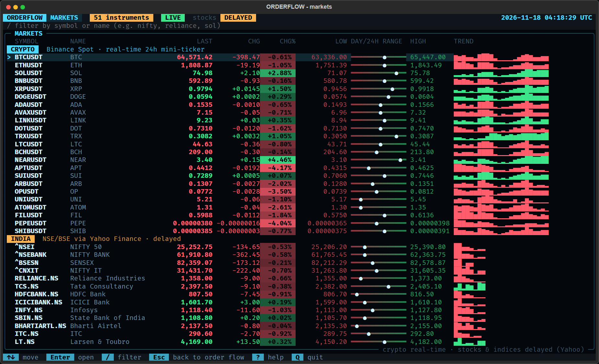
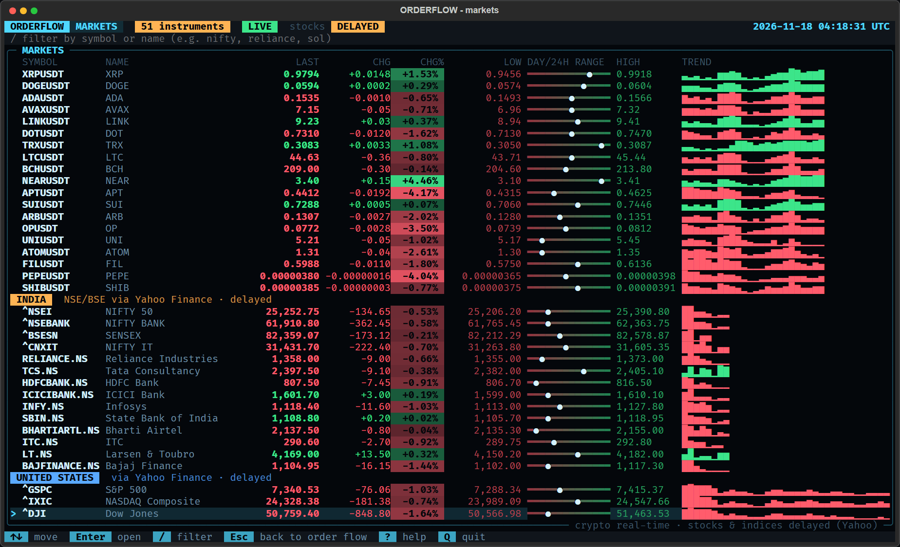
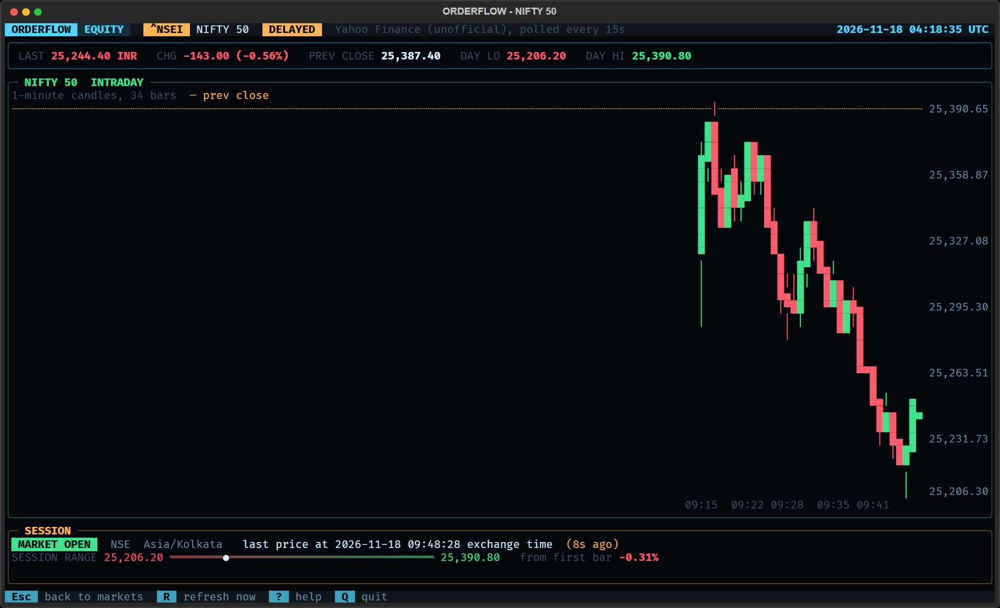
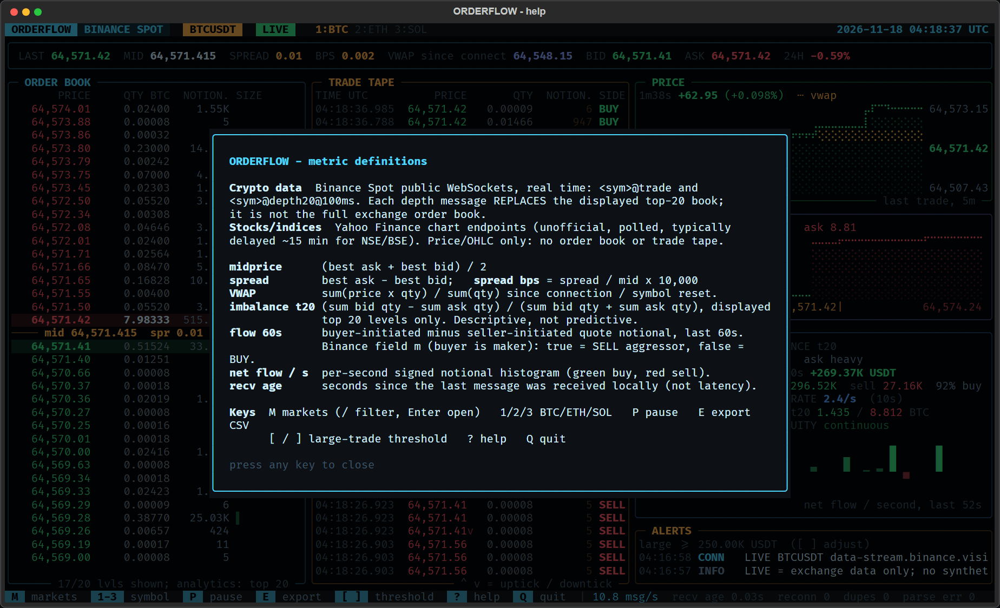

# ORDERFLOW

A keyboard-driven market terminal with a sci-fi HUD look. It shows live Binance Spot order flow
for 23 crypto pairs, plus a delayed watchlist of Indian, US and global stocks and indices.



Free, no API keys, no accounts, no Docker, no database. Just Python.

## Screens

**Order flow** (crypto, real time). Top-20 order book, a trade tape with up/down ticks and
large-trade highlights, a price chart with a VWAP line, a slim cumulative-depth curve, an
arc-reactor gauge for order-book imbalance, rolling signed trade flow with a per-second histogram,
and alerts.

**Markets** (`M`). A watchlist of crypto (real-time) and NIFTY 50, NIFTY BANK, SENSEX, NIFTY IT,
Reliance, TCS, HDFC Bank, ICICI Bank, Infosys, SBI, S&P 500, NASDAQ, Apple, NVIDIA and more
(delayed). Each row has a change heat cell, a day-range track and a trend sparkline.




**Equity** (`Enter` on a stock or index). 1-minute intraday candlesticks with a previous-close
line, session range and market open/closed status.



## Get it

**Download:** [Download the ZIP](https://github.com/jaisnavbuildsrandomshit/orderflow-terminal/archive/refs/heads/main.zip), unzip it, then follow the
steps below. Or clone it:

```bash
git clone https://github.com/jaisnavbuildsrandomshit/orderflow-terminal.git
cd orderflow-terminal
```

You need Python 3.11 or newer (<https://www.python.org/downloads/>).

## Run it

**Windows (PowerShell or Windows Terminal)**: double-click `start.cmd`, or:

```powershell
.\start.cmd
```

It creates `.venv` on first run, installs dependencies when `pyproject.toml` changes, and
launches the app. If something fails, the window stays open with the error.

Manual setup on Windows:

```powershell
py -3 -m venv .venv
.\.venv\Scripts\python -m pip install -e ".[dev]"
.\.venv\Scripts\python -m orderflow
```

**macOS / Linux**

```bash
python3 -m venv .venv
.venv/bin/python -m pip install -e ".[dev]"
.venv/bin/python -m orderflow
```

Options: `--symbol ETHUSDT`, `--large 500000` (large-trade threshold in USDT), `--ascii`
(ASCII-only charts; automatic when the terminal encoding is not UTF-8),
`--endpoint wss://...` (override the WebSocket base URL), `--log path`.

The layout is designed for 140x42. At narrower or shorter sizes (down to about 100x30) the
chart column moves below the book and tape, and you can scroll to it with the mouse wheel.

Colors are disabled if your environment sets `NO_COLOR`. Unset it to get the full palette,
for example `Remove-Item Env:NO_COLOR` in PowerShell.

## Controls

| Key | Action |
| --- | --- |
| `M` | markets watchlist (`Up`/`Down` or `j`/`k` move, `/` filter, `Enter` open, `Esc` back) |
| `1` `2` `3` | quick switch to BTCUSDT / ETHUSDT / SOLUSDT (any of the 23 pairs via `M`) |
| `P` | pause / resume rendering (ingestion continues; the header shows `PAUSED` and the view age) |
| `E` | export recent trades (up to 5,000) to `exports/orderflow_<SYM>_<UTC>.csv` |
| `[` `]` | lower / raise the large-trade alert threshold |
| `R` | (equity screen) refresh now |
| `?` | help and metric definitions |
| `Q` | quit (cancels the feed and closes the socket cleanly) |



## Data sources

**Crypto (real time).** One combined-stream WebSocket per symbol:
`wss://data-stream.binance.vision/stream?streams=<sym>@trade/<sym>@depth20@100ms`
(the market-data-only endpoint), with fallback to `stream.binance.com:9443` and `:443`.

* `<sym>@trade`: individual trades. `m` = "is the buyer the market maker?".
  `m=true` means the seller crossed the spread (**SELL** aggressor). `m=false` means **BUY**.
* `<sym>@depth20@100ms`: top 20 bid/ask levels every 100 ms. Each message **replaces** the
  displayed book. It is a partial snapshot, not a diff, and **not the full exchange order book**.
* `!miniTicker@arr`: all-market 24h tickers, used for the watchlist.

Connections follow Binance's rules. The server pings every 20 s and the client answers
automatically. Connections are dropped at 24 h, so ORDERFLOW rolls over at 23.5 h. If no frame
arrives for 30 s the connection is treated as dead. Reconnects use exponential backoff with
jitter (capped at 30 s) and rotate endpoints.

**Stocks and indices (delayed).** There is no free, keyless, real-time feed for NSE/BSE or US
equities with an order book. ORDERFLOW uses Yahoo Finance's public chart endpoints, polled every
15 to 30 seconds:

* `/v7/finance/spark` for the watchlist
* `/v8/finance/chart?interval=1m&range=1d` for the equity screen

These endpoints are **unofficial** and can change or rate-limit. NSE/BSE quotes are typically
about 15 minutes delayed. Every equity view is labelled `DELAYED` and shows the exchange time of
the last price. Stocks have price and OHLC only, with no order book, tape or order-flow metrics.
Edit `EQUITIES` in `orderflow/markets.py` to change the list (Yahoo symbols like `^NSEI`,
`RELIANCE.NS`, `AAPL`).

**Honest status.** The header shows `CONNECTING`, `LIVE`, `STALE`, `RECONNECTING` or `OFFLINE`.
`STALE` means connected but no message for over 5 s. There is no synthetic or demo data path:
offline means empty panels.

Official docs:
* Binance WebSocket streams: <https://developers.binance.com/docs/binance-spot-api-docs/web-socket-streams>
* Source markdown: <https://github.com/binance/binance-spot-api-docs/blob/master/web-socket-streams.md>

## Metrics and formulas

| Metric | Definition |
| --- | --- |
| midprice | (best ask + best bid) / 2 |
| spread | best ask - best bid |
| spread bps | spread / midprice x 10,000 |
| trade notional | price x base quantity (USDT) |
| session VWAP | sum(price x qty) / sum(qty) over trades **since connection / symbol reset**. Not a full-day VWAP. |
| imbalance (top 20) | (sum displayed bid qty - sum displayed ask qty) / (sum bid qty + sum ask qty), in [-1, 1] |
| signed flow 60 s | buyer-initiated quote notional - seller-initiated quote notional, last 60 s |
| trade rate | trades per second over the last 10 s |
| recv age | seconds since the last message was received locally. Not network latency. |

Undefined values (empty book, zero denominators, no trades) display as `--`. Rolling windows
expire by time even when no trades arrive. Flow shows `warm n/60s` until the window has 60 s of
continuous data. Imbalance describes displayed liquidity only and is **not** a price prediction.
A large trade is just a notional threshold and says nothing about who traded.

## Architecture

```
orderflow/
  feed.py     transport: connect, keepalive, rollover, backoff+jitter, endpoint fallback, cancel
  state.py    parsing + MarketState: Decimal book/trade state, bounded deques, rolling sums
  markets.py  watchlist: Binance !miniTicker@arr, REST klines, Yahoo spark/chart polling
  charts.py   braille line, candlestick, diverging histogram, ring gauge, sparkline, colour blending
  render.py   pure state -> rich.Text renderers for every panel and screen
  app.py      Textual app: order-flow, markets and equity screens, render timers, CSV export
```

* **Ingestion vs rendering.** The feed task parses and applies each message to `MarketState`
  (cheap, O(levels)). A separate timer renders about 8 times per second, so message bursts never
  drive redraws. CSV export runs in a worker thread.
* **Precision.** Prices and quantities are `Decimal`, parsed from Binance's string fields.
* **Bounded memory.** 5,000 trades, 600 s of price history, 200 alerts. Rolling windows are
  deques with running sums.
* **Isolation.** Each feed carries a generation number. Switching symbols cancels and awaits the
  old task, bumps the generation and resets all symbol state. Late callbacks from old
  generations are dropped, and `MarketState` also rejects events for a different symbol.
* **Continuity.** Trade IDs are monotonic per symbol, so IDs at or below the last seen are
  counted as duplicates and ignored. Skipped IDs are counted as missed. On a disconnect the book
  is cleared and rolling windows restart. VWAP continues and the gap is shown under continuity.
* Malformed messages are counted and reported briefly. Diagnostics go to `logs/orderflow.log`.

## Tests

```bash
python -m pytest -q
```

26 tests with small synthetic fixtures fed straight into `MarketState` (fixtures never appear as
LIVE data), plus headless Textual runs with networking disabled. They cover aggressor
classification, spread / VWAP / imbalance including zero and missing data, rolling-window expiry,
snapshot replacement and sorting, duplicates, symbol and reconnect isolation, CSV export,
pause, narrow reflow, the Yahoo and Binance parsers, charts, and the markets/equity screens.

## Limitations

* Analytics cover only the **displayed top 20 levels**, not the full order book.
* VWAP, flow and tape start empty at launch or symbol switch. There is no historical backfill.
* Stocks and indices are delayed and come from an unofficial endpoint.
* Binance restricts some regions (HTTP 451). The app reports this but cannot work around it.
* Market data only. There is no trading, no accounts, no prediction and no backtesting.
* Not financial advice. Not affiliated with Binance or Yahoo.

## Credits

Built with Python, [Textual](https://textual.textualize.io/) and
[websockets](https://websockets.readthedocs.io/). Much of the code was written with Claude Code,
an AI coding tool.

## License

MIT. See [LICENSE](LICENSE).
